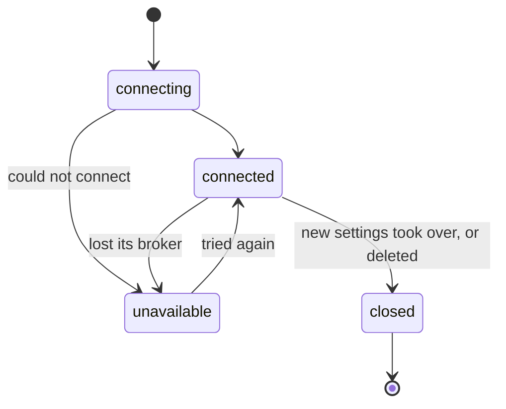

# Connections

A connection is an entity of the extension: a `kind` of broker and its `settings`.

```json
{ "id": "connection_...", "name": "orders", "kind": "kafka", "settings": { "bootstrap_servers": ["kafka:9092"] } }
```

| Entity | Kind | Admin API |
|---|---|---|
| Event broker connection | `event-brokers.extensions.cloud-apim.com/EventBrokerConnection` | `/apis/event-brokers.extensions.cloud-apim.com/v1/event-broker-connections` |

The settings of each kind: [Kafka](./kafka.md), [RabbitMQ](./rabbitmq.md), [Pulsar](./pulsar.md),
[Redis](./redis.md), [MQTT](./mqtt.md), [Artemis](./artemis.md), and [TLS and
authentication](./tls-and-auth.md), the same on every kind.

## Settings are checked

The admin API refuses settings that do not fit their kind, with every field at fault:

```json
{
  "error": "bad_request",
  "errors": ["settings.bootstrap_servers: required", "settings.servers: unknown field"],
  "http_status_code": 400
}
```

Unknown fields are errors: a typo is never silently ignored. `GET .../event-broker-connections/_template?kind=<kind>`
gives a valid starting point, which the backoffice form starts from.

Any string can be a [vault](https://www.otoroshi.io/docs/topics/secrets) reference
(`"password": "${vault://local/brokers/kafka_password}"`): the admin API keeps the reference, the
clients get the secret. Its format is only checked once resolved.

A connection whose stored settings are wrong (written by hand in the datastore, or in the format of an
older version) stays listed, so that it can be fixed: it is `unavailable` with the errors, and is not
tried again until its settings change.

## Every node keeps its clients

Every Otoroshi node keeps one client per connection, **connected in the background** as soon as the
connection exists: no request ever waits for a broker to be reached.

- A connection that cannot connect is **unavailable** and tries again, waiting twice as long each time
  (1s up to 30s). Its routes answer `503` with a `Retry-After` at once.
- A connected client is **checked** against its broker every 10s. A broker that stops answering makes
  the connection unavailable until it answers again; after 3 failed checks in a row the client is
  closed and built again.
- **New settings** get a client of their own, which takes over once connected: the previous settings
  serve the requests until then, and keep doing so if the new ones never connect (the status says
  why). The streams still open on the previous client may go on for 30s before it is closed.
- A deleted connection's client is closed the same way.



Those timings are [configurable](../reference/configuration.md).

## Status

The state of the connections of a node is in the backoffice list, and in the admin API:

```bash
curl http://otoroshi-api.oto.tools:8080/api/extensions/cloud-apim/event-brokers/connections/_status -u admin-api-apikey-id:admin-api-apikey-secret
curl http://otoroshi-api.oto.tools:8080/api/extensions/cloud-apim/event-brokers/connections/<id>/_status -u ...
```

```json
{
  "id": "connection_...", "name": "orders", "kind": "kafka",
  "state": "connected", "since": 1792663171364, "error": null, "failures": 0,
  "last_check_at": 1792663181364, "next_attempt_at": null,
  "pending": null,
  "traffic": { "published": 1204, "publish_failed": 2, "consumed": 980, "acked": 980, "subscriptions": 3, "publish_ms": { "mean": 4.2, "max": 87 } }
}
```

`state` is `connecting`, `connected`, `unavailable` or `closed`. `pending` is the status of new settings
that are not connected yet. In a cluster each node has its own clients: the admin API answers for the
node serving it. Each change of state is also an [Otoroshi event](../reference/events.md).

A connection can be tried from its page in the backoffice, or from the admin API: see [Try a
connection](../features/try-a-connection.md).

## Defaults

A call that names no topic (queue, channel, stream, address) uses the default one of its connection,
and is refused with a `400` when there is none (a publish gets a failed result for each event).
