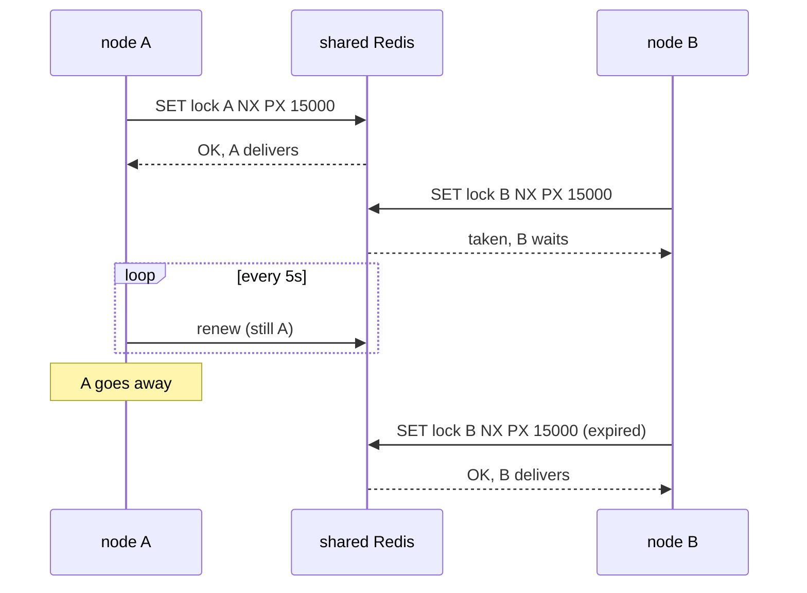

# Running in a cluster

In an Otoroshi cluster (leaders and workers), the extension runs on every node.

## Every node on its own

- **Connections**: every node keeps its own client of each connection, and connects it in the
  background. The status, the traffic and the try-it routes of the admin API answer for the node
  serving them (the leader, in a cluster).
- **Routes**: a call is served by the node it reaches, with that node's client. Consumers in a group
  on several nodes share the events, as the broker shares them between the members of a group.
- **MQTT client ids** get a random suffix: two nodes never share one.
- **Request reply**: every node reads the replies and keeps those of its own requests.

## What the nodes share: webhooks

A webhook is delivered by one node at a time: two nodes delivering it would post every event twice.
The nodes decide which one in a Redis they share, through Otoroshi's stateful clients:

```hocon
otoroshi.admin-extensions.configurations.cloud-apim_extensions_eventbrokers.webhooks {
  redis.uri = "redis://shared-redis:6379"   # CLOUD_APIM_EXTENSIONS_EVENT_BROKERS_WEBHOOKS_REDIS_URI
  lock-ttl = 15s
  node-kinds = ["leader", "worker"]
}
```

- Each webhook has a lock in that Redis (`cloud-apim:event-brokers:webhooks:<id>:owner`), holding the
  node that delivers it. The node renews it every third of `lock-ttl`.
- A node that goes away, or loses that Redis, stops renewing: once its lock expires, another node
  takes the webhook over, and goes on where the group of the webhook stopped.
- `node-kinds`: which nodes may deliver (`leader`, `worker`).
- A cluster **without** that Redis delivers no webhook: their status says why. Alone (no cluster),
  Otoroshi delivers them all, without Redis.

Any Redis the nodes reach will do, the one of the Otoroshi datastore included.


