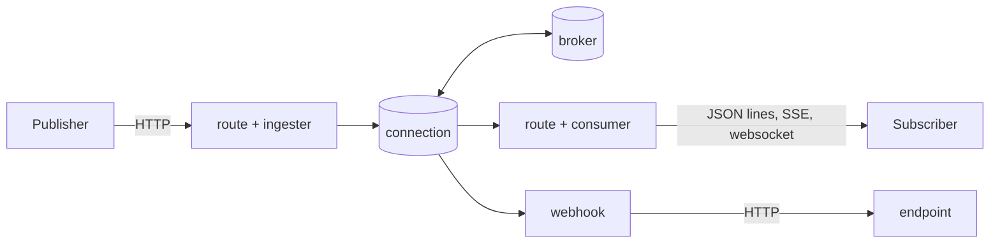

# Overview

The Event Brokers extension is an [Otoroshi](https://www.otoroshi.io/) admin extension that **puts
event brokers behind your routes**. Clients publish events with a plain HTTP call, and consume them
as newline-delimited JSON, as server-sent events or over a websocket. The brokers stay on the private
network: Otoroshi decides who may reach them, with everything a route has (api keys, JWT, quotas,
authentication modules), and what each caller may ask.

| Kind | Broker | Client |
|---|---|---|
| `kafka` | Apache Kafka | pekko-connectors-kafka (from Otoroshi) |
| `rabbitmq` | RabbitMQ (AMQP 0.9.1), classic, quorum and stream queues | amqp-client 5 |
| `pulsar` | Apache Pulsar | Pulsar client (from Otoroshi) |
| `redis` | Redis pub/sub, or Redis streams | Lettuce (from Otoroshi) |
| `mqtt` | any MQTT 5 or 3.1.1 broker, over TCP or websockets | HiveMQ MQTT client |
| `artemis` | ActiveMQ Artemis, on its core protocol | Artemis core client (from Otoroshi) |

## The pieces

- A **connection** ([Connections](./connections/overview.md)) is an entity of the extension: a kind
  of broker and its settings. Every Otoroshi node keeps one client per connection, connected in the
  background, checked, and rebuilt when it fails.
- **Plugins** ([Routes](./routes/plugins.md)) put a connection behind a route: the HTTP ingester, the
  HTTP, SSE and websocket consumers, request reply. The route fixes what its callers may ask.
- **Every event is a [CloudEvent](./cloudevents.md)**, with the protocol binding of each broker.
- **Webhooks** ([Webhooks](./features/webhooks.md)) push the events of a connection to HTTP
  endpoints, retried and dead-lettered.
- The [data exporter](./features/data-exporter.md) sends Otoroshi's own events to a broker, the
  [workflow functions](./features/workflows.md) publish and consume from Otoroshi workflows.
- Everything is [observable](./operations/observability.md): connection states, traffic, the lag of
  the groups, as Otoroshi events, metrics and admin API routes.

## Each broker at its best

The extension does not reduce the brokers to what they have in common. A consumer asks for what its
broker can do (a group, at-least-once delivery, a start position), and what it cannot do is refused
with a `400` rather than silently ignored. Kafka keys, partitions and offsets, RabbitMQ publisher
confirms, topologies and streams, Pulsar subscription types, Redis streams consumer groups and
claims, MQTT 5 shared subscriptions and user properties, Artemis routing types, selectors, message
groups and duplicate detection: each is available where it exists. See
[Consuming](./routes/consuming.md) for what each broker can do.

## Next

- [Quickstart](./quickstart.md): a broker, two routes, an event, in five minutes
- [Install](./install.md): the jar, and the configuration of the extension
