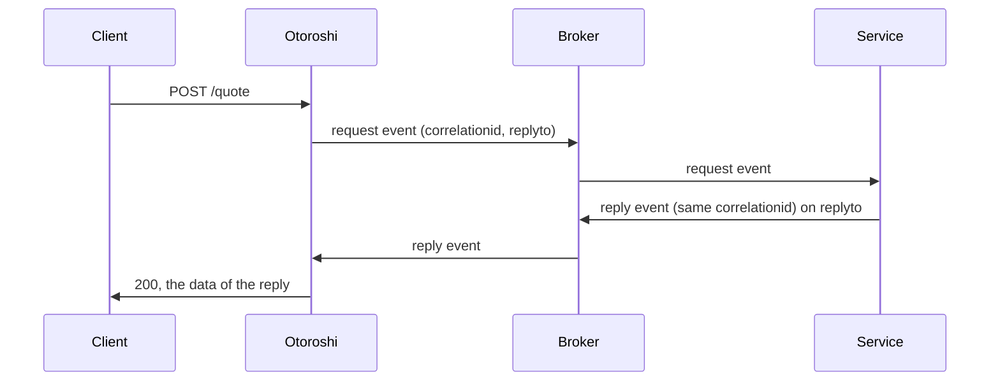

# Request reply

The **Events request reply** plugin publishes the body of a call as an event, waits for the event
that replies to it, and answers with it.

- The request is the body of the call, read the way the [ingester](./publishing.md) reads it, with two
  extensions: `correlationid` (new for each call) and `replyto`. Where the broker has them, its own
  fields are set too: the AMQP `reply_to` and `correlation_id`, the MQTT 5 response topic.
- The service answering publishes an event with the same `correlationid` where `replyto` says. Its
  data is the response, its `datacontenttype` the content type, a `status` extension the HTTP status
  (200 by default). The response carries `X-Correlation-Id`.
- No reply within `timeout` is a `504`.

## Options

| Option | |
|---|---|
| `topic` (and the other publish options) | where the requests go |
| `reply_to` | required: where the replies go, given to the service in `replyto` |
| `reply_options` | how to read the replies (JSON): `{"topic": "<reply_to>"}` by default |
| `timeout` | millis, 10000 |

On RabbitMQ, the replies are read through an exchange: `{"exchange": "amq.direct", "routing_key": "replies"}`,
and the service publishes its reply to that exchange with that routing key.

## How replies are read

Every node reads the replies, without a group (each one gets them all), and keeps those of its own
requests: one subscription per connection and reply destination, made on the first call. On Kafka,
Pulsar and Redis streams it reads them from when it started listening: a reply topic that does not
exist yet, or a subscription still being set up, loses none. On the other brokers, a request waits
for the subscription of the replies to be in place before it goes out.
